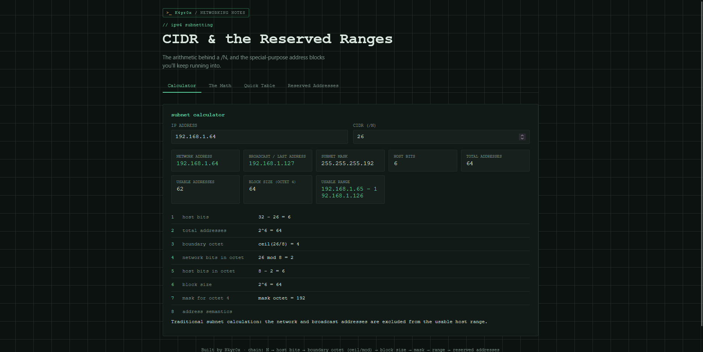

# K4YR0X IPv4 / CIDR Reference

[🌐 Open the Live Website](https://k4yr0x.github.io/k4yr0x-ipv4-cidr-reference/)

An interactive IPv4 subnetting calculator and networking study reference built with HTML, CSS, and vanilla JavaScript.

> Built with assistance from ChatGPT and Claude

## Features

### Subnet Calculator
- Calculate the network address and broadcast address.
- Determine the subnet mask and CIDR prefix.
- Calculate the number of host bits and total IPv4 addresses.
- Identify the usable host range and conventional usable-host count.
- Display a step-by-step breakdown of the subnetting calculation.
- Validate IPv4 addresses and CIDR prefix input.
- Handle edge cases, including `/0`, `/31`, and `/32`.

### Subnetting Math
- Understand the relationship between network bits and host bits.
- Learn how CIDR prefixes determine subnet size.
- Explore boundary octets using ceiling and modulo operations.
- Calculate block sizes and subnet mask octets.
- Follow a worked example using `192.168.1.64/26`.

### Quick Reference Table
- Compare common CIDR prefixes.
- Review host-bit counts, total addresses, and usable-address counts.
- Check block sizes and subnet mask values at a glance.

### Reserved and Special-Purpose Addresses
Learn about common IPv4 addressing concepts and ranges, including:

- Private IPv4 ranges defined by RFC 1918.
- Loopback addresses.
- Link-local addresses and APIPA.
- Multicast addresses.
- Network and broadcast addresses.
- The special uses of `0.0.0.0` and `255.255.255.255`.
- Default gateways and their role in routing.

## Getting Started

No installation, build tools, or external dependencies are required.

1. Clone or download this repository.
2. Open `index.html` in a modern web browser.
3. Enter an IPv4 address and CIDR prefix in the calculator.

### Example

Input:

- IP address: `192.168.1.64`
- CIDR prefix: `/26`

The calculator determines the corresponding subnet information and shows the calculation steps.

## Built With

- HTML5
- CSS3
- Vanilla JavaScript

## Purpose

This project was created to make IPv4 subnetting easier to understand and to keep useful networking references in one place while learning cybersecurity.

It is an educational tool, not a replacement for authoritative networking documentation or operational network validation.

## License

Distributed under the MIT License. See [LICENSE](LICENSE) for the license terms.

## Author

**K4yr0x**
